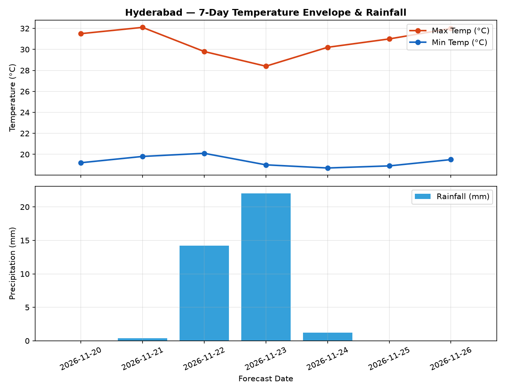

# Weather Forecast & Alert Application

A Python weather intelligence application that ingests multi-city forecasts, persists daily time-series in SQLite, evaluates configurable risk rules (`RAIN_SOON`, `HEAT_WAVE`, `WIND_HIGH`, `UV_HIGH`), exports CSV alert reports, plots 7-day temperature/rainfall charts, and exposes a FastAPI service.

## Setup & How to Run
```bash
python -m venv venv
source venv/bin/activate
pip install -r requirements.txt
cp .env.example .env
python main.py
python -m unittest discover -s tests -v
```

## Generated Forecast Chart

