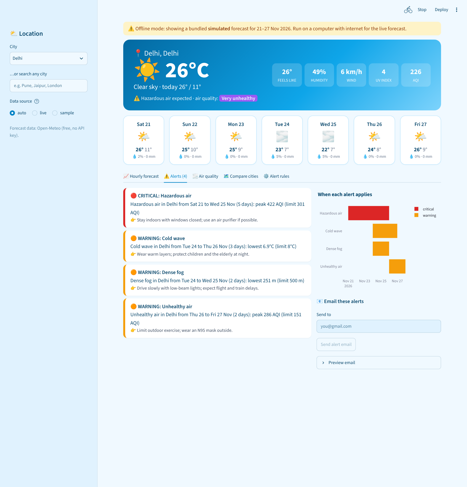
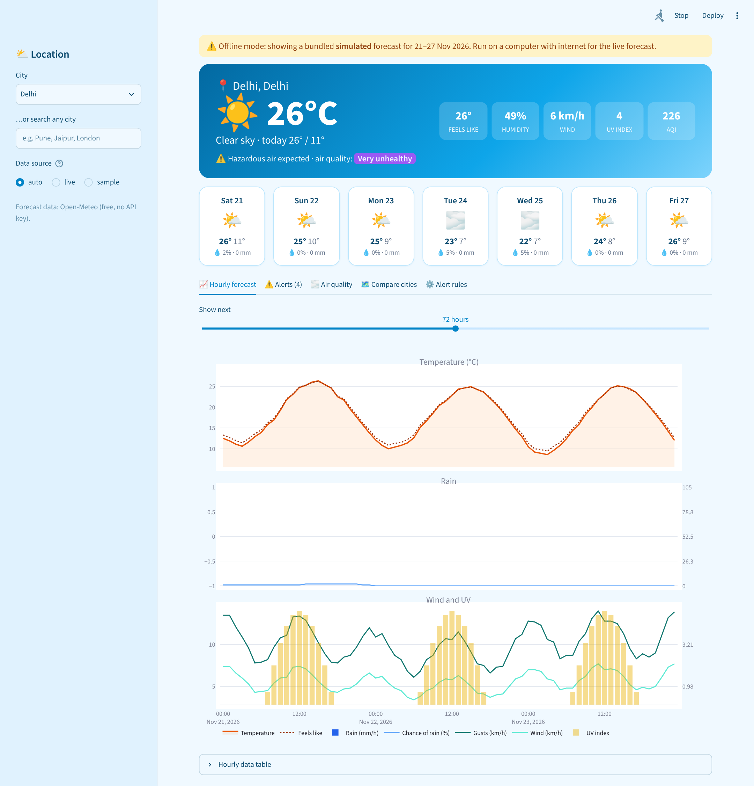
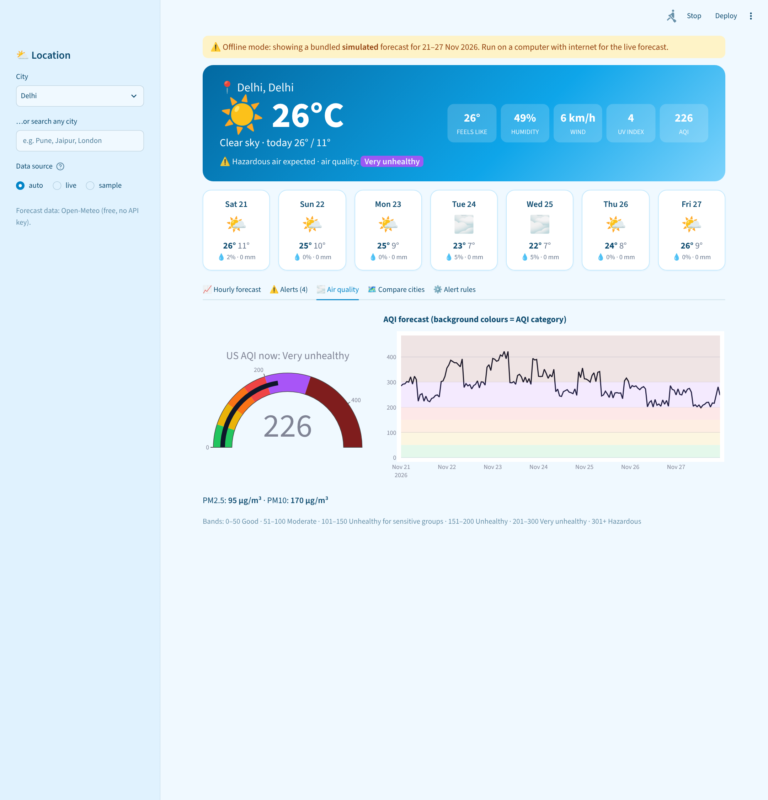
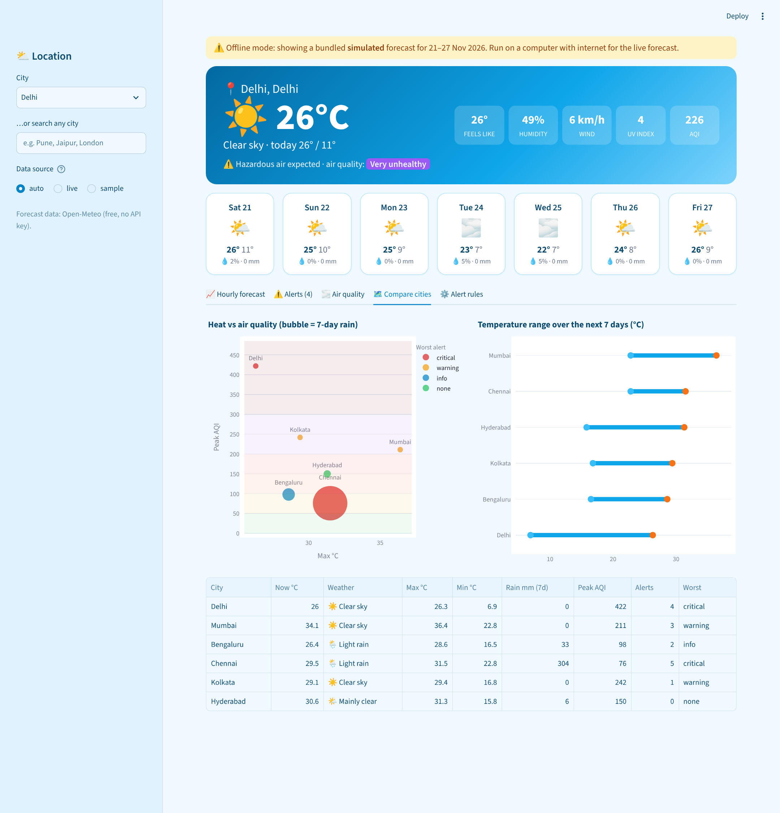
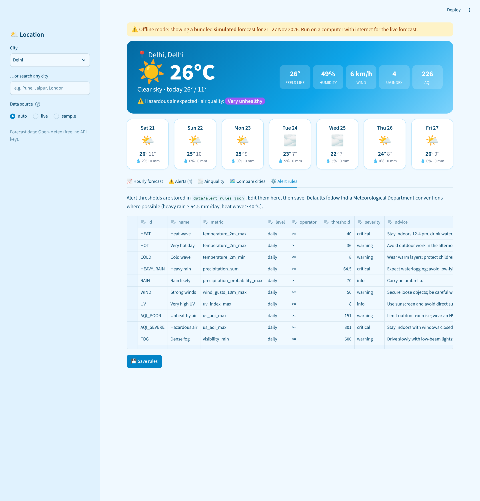
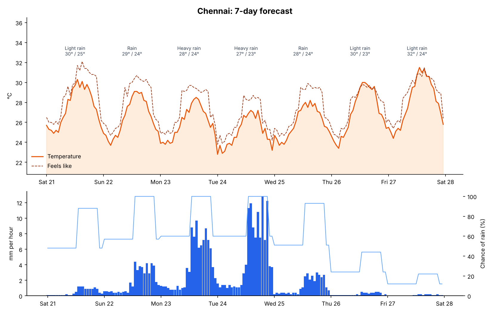
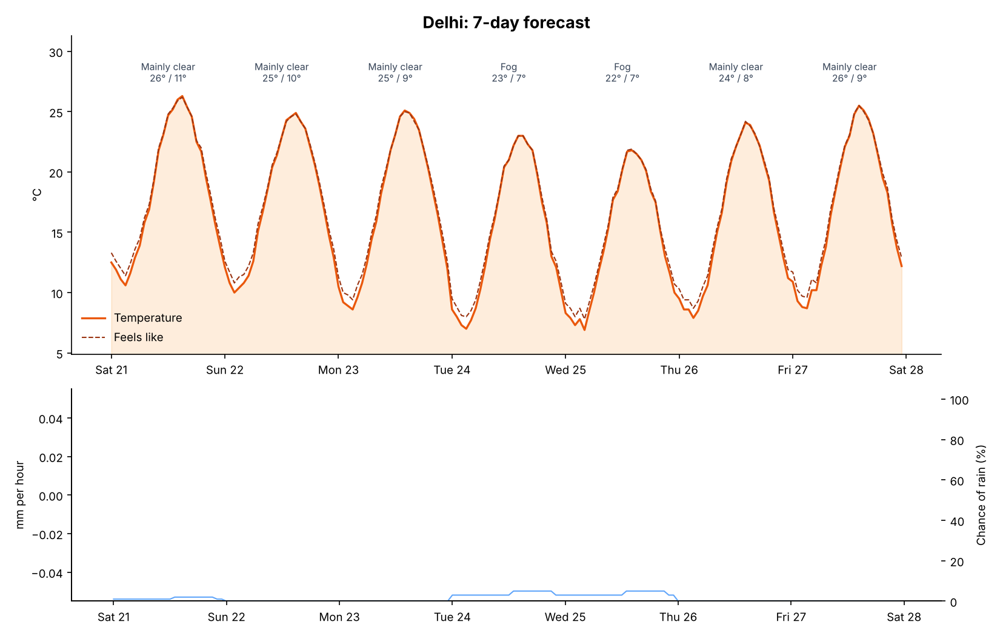
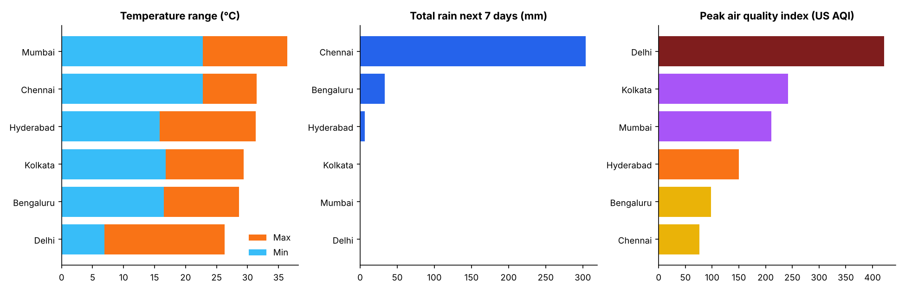

# Weather Forecast & Alert Application

🌐 **Live report:** https://rohitsingh83.github.io/Weather-Forecast-Alert-Application/ · 💻 **Source:** https://github.com/rohitsingh83/Weather-Forecast-Alert-Application

A Python weather app that shows **current conditions, an hourly forecast, a 7-day forecast and air quality** for
any city, and raises **early-warning alerts** for heat waves, cold waves, heavy rain, strong winds, dense fog,
high UV and unhealthy air. Each alert explains what to do. Alerts can be **emailed automatically** on a
schedule, without repeats. Data comes from the free **Open-Meteo** APIs (no API key needed).



> The screenshots and sample outputs were made with bundled **simulated** forecasts (the build machine was
> offline). On a computer with internet access, the same commands use the **live** Open-Meteo forecast.

---

## Problem statement

Forecasts are everywhere, but people still get caught out by heat, floods, smog and fog, because nobody checks
every day and raw numbers don't say when to worry. This application turns forecast data into clear, timely
warnings with advice, and delivers them automatically.

## Industry relevance

The same pattern of **API → processing → rules → notification** runs weather warning services (IMD), agritech
advisories for farmers, logistics and fleet routing, airline and railway operations during fog season,
insurance risk monitoring, and smart-city flood preparedness. The project demonstrates **REST API integration,
resilient networking, data processing, rule engines, automation and notifications**, which suits **Python
Developer, Automation, Backend and Data** roles.

## Features

- **Search any city** (geocoding API) or pick from 6 preset Indian cities
- **Current conditions**: temperature, feels-like, humidity, wind, UV, AQI with colour-coded category
- **7-day forecast cards** and **interactive hourly charts** (temperature, rain amount and probability, wind, UV)
- **Air quality**: US AQI gauge, hourly AQI forecast with category bands, PM2.5 and PM10
- **10 configurable alert rules** with IMD-style defaults (heavy rain ≥ 64.5 mm, heat wave ≥ 40 °C, …), editable in the dashboard
- **Smart alerts**: most severe per hazard, consecutive days merged ("Hazardous air from Sat 21 to Wed 25 Nov, peak 422 AQI")
- **No repeated notifications**: SQLite history emails only new or worsening alerts
- **Email alerts** (HTML, via SMTP) with a safe dry-run mode
- **City comparison**: heat vs air quality, temperature ranges, alert summary
- **Resilient API client**: timeouts, retries with backoff, cache, offline sample fallback
- **CLI** with `forecast`, `alerts`, `compare` and a `watch` scheduler
- **12 automated tests**, including a simulated network failure

## Tech stack

| Area | Tools |
|---|---|
| Language | Python 3.10+ |
| APIs | Open-Meteo geocoding, forecast and air-quality APIs via `requests` |
| Data | Pandas |
| Alerts | JSON rule file, Python `operator` module, SQLite history |
| Notifications | smtplib + email.message, python-dotenv |
| Visualisation | Plotly (dashboard), Matplotlib (PNG charts) |
| Dashboard | Streamlit |
| CLI | argparse, Rich |
| Testing | pytest (with monkeypatch) |

## How it works

```
city → geocoding API → forecast + air-quality APIs → JSON → Pandas (hourly & daily)
     → evaluate alert rules → keep most severe · merge consecutive days → new-alert check (SQLite)
     → dashboard · CLI · CSV · email
```

Default rules and their basis, plus the architecture: [docs/PROJECT_EXPLANATION.md](docs/PROJECT_EXPLANATION.md)

## Folder structure

```
Weather-Forecast-Alert-Application/
├── data/
│   ├── cities.json           # preset cities with coordinates
│   ├── alert_rules.json      # editable alert thresholds
│   └── sample/               # offline sample forecasts (Open-Meteo JSON format, simulated)
├── src/
│   ├── api_client.py         # geocoding, forecast, air quality; retries, cache, fallback
│   ├── processing.py         # JSON → DataFrames, WMO codes, AQI categories
│   ├── alerts.py             # rule engine: evaluate, prioritise, merge
│   ├── notifier.py           # alert history (SQLite) and email
│   └── charts.py             # Matplotlib charts
├── scripts/
│   └── generate_sample_data.py
├── outputs/                  # active_alerts.csv, city_comparison.csv, sample alert email
├── images/                   # charts and dashboard screenshots
├── docs/                     # live report (index.html, GitHub Pages), project explanation, interview Q&A
├── tests/test_weather.py
├── main.py                   # command-line tool
├── app.py                    # Streamlit dashboard
├── .env.example              # optional email settings
├── requirements.txt
└── .gitignore
```

## Installation

```bash
git clone https://github.com/rohitsingh83/Weather-Forecast-Alert-Application.git
cd Weather-Forecast-Alert-Application
```

Create and activate a virtual environment.

On Windows:

```bash
python -m venv venv
venv\Scripts\activate
```

On macOS or Linux:

```bash
python3 -m venv venv
source venv/bin/activate
```

Install the dependencies:

```bash
pip install -r requirements.txt
```

**Optional, for email alerts:** copy `.env.example` to `.env`, add your Gmail address and an
[App Password](https://myaccount.google.com/apppasswords), and set `DRY_RUN=false`.

## How to run

Open the dashboard:

```bash
streamlit run app.py
```

Forecast and alerts for a city:

```bash
python main.py forecast Chennai
```

Any city in the world (live mode):

```bash
python main.py forecast "Jaipur"
```

Check all preset cities and email new alerts:

```bash
python main.py alerts --email you@gmail.com
```

Compare cities:

```bash
python main.py compare
```

Keep checking every hour:

```bash
python main.py watch --every 60
```

Force offline sample data:

```bash
python main.py --source sample forecast Delhi
```

Run the tests:

```bash
python -m pytest -q
```

## Sample output

`python main.py --source sample forecast Chennai` *(simulated forecast)*:

```text
╭───────────── 📍 Chennai, Tamil Nadu ──────────────╮
│ 🌦️  29.5°C  Light rain · feels like 31.2°C        │
│ 💧 76% humidity · 💨 15 km/h wind · AQI 47 (Good) │
│ offline SAMPLE forecast (simulated)               │
╰───────────────────────────────────────────────────╯
 Day          Weather      Max  Min    Rain  Chance    Gusts  UV  AQI
 Sat 21 Nov   Light rain   30°  25°   12 mm     88%  35 km/h   5   67
 Sun 22 Nov   Rain         29°  24°   45 mm    100%  44 km/h   3   51
 Mon 23 Nov   Heavy rain   28°  24°   92 mm    100%  60 km/h   2   42
 Tue 24 Nov   Heavy rain   27°  23°  118 mm    100%  71 km/h   2   39
 Wed 25 Nov   Rain         28°  24°   30 mm     93%  44 km/h   4   49
 ...
 CRITICAL  Heavy rain in Chennai from Mon 23 to Tue 24 Nov (2 days): peak 118 mm (limit 64.5 mm)
           → Expect waterlogging; avoid low-lying roads and plan travel early.
 WARNING   Strong winds in Chennai from Mon 23 to Tue 24 Nov (2 days): peak 71.4 km/h (limit 50 km/h)
           → Secure loose objects; be careful with two-wheelers.
```

`python main.py --source sample compare`:

```text
 City       Max temp  Min temp  Rain (mm)  Peak AQI                              Alerts  Critical
 Delhi        26.3°C     6.9°C          0  422 (Hazardous)                            4         1
 Mumbai       36.4°C    22.8°C          0  211 (Very unhealthy)                       3         0
 Bengaluru    28.6°C    16.5°C         33  98 (Moderate)                              2         0
 Chennai      31.5°C    22.8°C        304  76 (Moderate)                              5         1
 Kolkata      29.4°C    16.8°C          0  242 (Very unhealthy)                       1         0
 Hyderabad    31.3°C    15.8°C          6  150 (Unhealthy for sensitive groups)       0         0
```

Running `python main.py alerts` twice: first run "15 new alert(s)", second run "0 new alert(s)".

Files: [`outputs/active_alerts.csv`](outputs/active_alerts.csv) ·
[`outputs/city_comparison.csv`](outputs/city_comparison.csv) · [`outputs/alert_emails/`](outputs/alert_emails)

## Screenshots

| Hourly forecast | Air quality |
|---|---|
|  |  |

| Compare cities | Editable alert rules |
|---|---|
|  |  |

Charts generated by the CLI:

| | |
|---|---|
|  |  |



## Learning outcomes

- Consuming REST APIs with query parameters, timeouts and error handling
- Building resilient clients: retries with exponential backoff, caching, graceful fallback
- Turning nested JSON into tidy Pandas tables and aggregating hourly to daily data
- Designing a configurable rule engine and avoiding alert fatigue
- Idempotent notifications with a SQLite history
- Sending HTML email securely with SMTP and `.env` secrets
- Interactive dashboards with Plotly subplots, gauges and timelines
- Testing network-dependent code with sample data and monkeypatching

## Interview preparation

13 common questions with HR and technical answers, starting with **"Explain your project"**:
[docs/INTERVIEW_QA.md](docs/INTERVIEW_QA.md)

## Disclaimer

Forecast data: [Open-Meteo](https://open-meteo.com/) (CC BY 4.0). Bundled sample forecasts are simulated.
For official warnings in India, always follow the India Meteorological Department (IMD).
