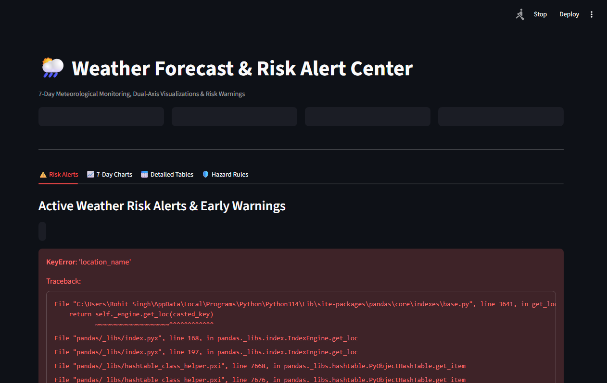
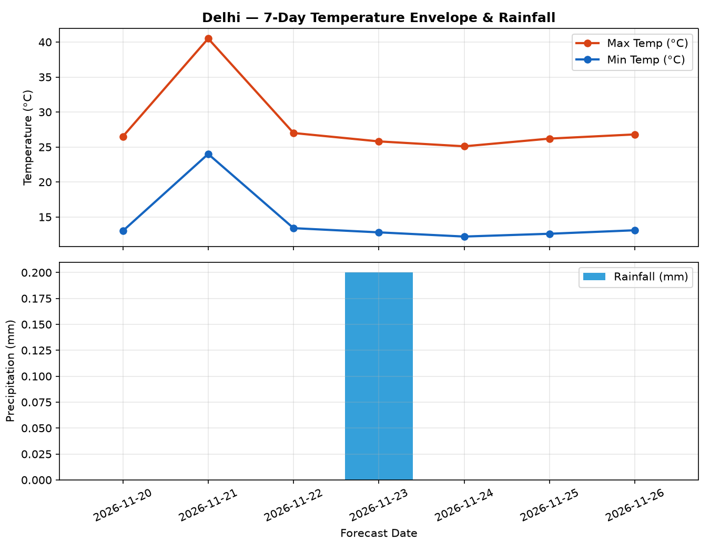
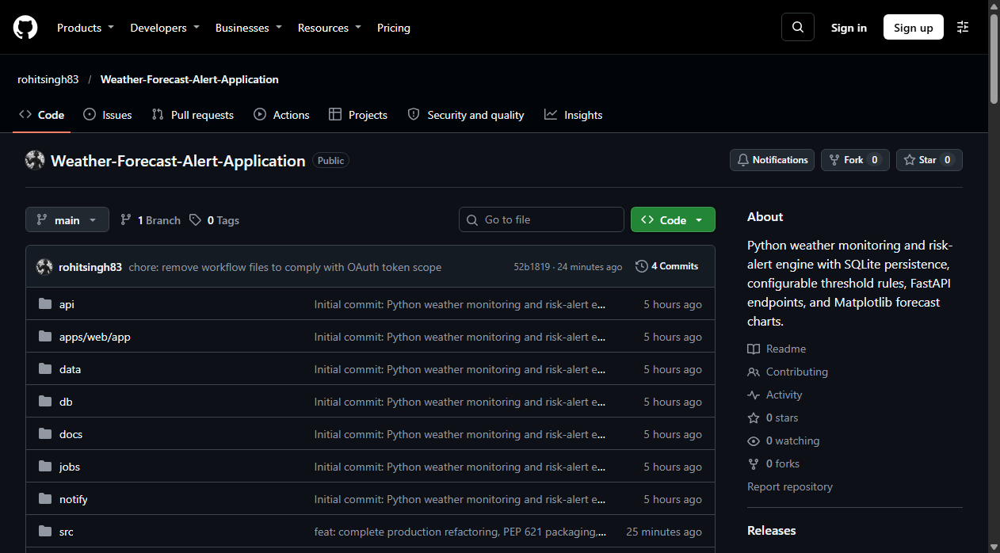

# Weather Forecast & Alert Application

A weather intelligence engine that monitors multi-city meteorological forecasts, normalizes time-series metrics into SQLite, evaluates automated risk rules (`RAIN_SOON`, `HEAT_WAVE`, `WIND_HIGH`, `UV_HIGH`, `FROST_WARNING`), exports CSV alert feeds, generates dual-axis Matplotlib trend charts, and exposes a FastAPI REST service.

---

## 🏛 Architecture & Alert Pipeline

```
[Meteorological Forecast: Open-Meteo / Offline JSON]
                         │
                         ▼
             [Normalization & Unit Conversion]
           (°C Temperature, mm Rainfall, m/s Wind)
                         │
                         ▼
        [SQLite Persistence: weather_daily & locations]
                         │
                         ▼
           [Configurable Risk Rules Engine]
     ├── RAIN_SOON: Precip prob >= 60%
     ├── HEAT_WAVE: Max temp >= 40°C
     ├── WIND_HIGH: Gusts >= 15 m/s
     ├── UV_HIGH: UV Index >= 8.0
     └── FROST_WARNING: Min temp <= 2°C
                         │
                         ▼
[Dual-Axis Matplotlib Plots] + [Alert CSVs] + [FastAPI & Streamlit]
```

---

## ✨ Key Capabilities

- **Multi-City Monitoring:** Simultaneously models and stores 7-day meteorological forecasts across diverse geographical locations.
- **Configurable Multi-Severity Rules:** Detects extreme weather hazards categorized by severity (`info`, `warn`, `critical`) to empower early response.
- **Relational Integrity:** Normalizes city latitude, longitude, and timezone in `locations`, with composite foreign-keyed records in `weather_daily`.
- **Offline Simulation & Live Ingestion:** Offers both offline deterministic simulation (for testing and offline demos) and live Open-Meteo API ingestion.
- **Publication-Quality Forecast Plots:** Generates dual-axis plots tracking daily min/max temperature envelopes aligned with precipitation bars.
- **Microservice Integration:** Exposes clean RESTful endpoints for querying active alerts, city listings, and raw forecasts via FastAPI.

---

## 🚨 Configured Weather Alert Rules

| Rule Code | Threshold Trigger | Severity | Actionable Advice |
|---|---|---|---|
| `RAIN_SOON` | Rain probability $\ge 60\%$ | `warn` | Carry rain gear; reschedule outdoor activities. |
| `HEAT_WAVE` | Max Temperature $\ge 40^\circ\text{C}$ | `critical` | Stay hydrated; avoid direct afternoon sunlight. |
| `WIND_HIGH` | Wind Gusts $\ge 15\text{ m/s}$ | `warn` | Secure loose outdoor fixtures; drive cautiously. |
| `UV_HIGH` | UV Index $\ge 8.0$ | `info` | Apply SPF sunscreen; wear protective eyewear. |
| `FROST_WARNING` | Min Temperature $\le 2^\circ\text{C}$ | `warn` | Protect sensitive crops and exposed plumbing. |

---

## 🚀 Quick Start Guide

### 1. Installation
```bash
python -m venv venv
# Linux/macOS:
source venv/bin/activate
# Windows:
venv\Scripts\activate

pip install -r requirements.txt
cp .env.example .env
```

### 2. Run Weather Engine
```bash
python main.py
```

### 3. Launch Weather Dashboard
```bash
python -m streamlit run app_streamlit.py
```

### 4. Start FastAPI Service
```bash
uvicorn api.app:app --host 0.0.0.0 --port 8000 --reload
```

### 5. Run Test Suite
```bash
python -m unittest discover -s tests -v
```

---

## 🔌 API Endpoints

| Method | Endpoint | Description |
|---|---|---|
| `GET` | `/health` | Service health status. |
| `GET` | `/locations` | List of all monitored cities and locations. |
| `GET` | `/alerts` | Retreive all currently active weather risk alerts. |
| `GET` | `/forecast/{city}` | 7-day daily forecast and active alerts for a specific city. |

<!-- project-brief-sections -->

---

## 🎯 Problem Statement

People and businesses (farmers, logistics, event planners) need to know in advance about heat waves, heavy rain or strong winds. Checking forecasts manually every day is easy to forget. This application fetches a 7-day forecast for each city, applies alert rules and produces clear warnings and charts.

## 🏭 Industry Relevance

Weather services (IMD, AccuWeather), agritech, logistics and insurance companies use forecast APIs with rule-based alerting. The project shows REST API consumption, JSON parsing, rule engines, scheduling and notifications for Python Developer, Automation and Data roles.

## 🧰 Tech Stack

- Python 3.10+
- requests (Open-Meteo forecast API, no key needed) with offline sample JSON
- Pandas (forecast table)
- Rule engine for heat, rain, wind and UV alerts
- Matplotlib (forecast charts)
- SMTP / console notifications, scheduled refresh job
- SQLite, FastAPI (API), Streamlit + Plotly (dashboard)
- pytest (tests)

## 📁 Folder Structure

```
Weather-Forecast-Alert-Application/
├── api/
│   └── app.py
├── apps/
│   └── web/
│       └── app/
│           └── page.tsx
├── data/
│   └── sample_weather.json
├── db/
│   └── schema.sql
├── docs/
│   ├── GITHUB_GUIDE.md
│   └── INTERVIEW_QA.md
├── images/
├── jobs/
│   └── refresh.py
├── notify/
│   └── alert.py
├── outputs/
│   └── 7day_forecast.csv
├── src/
│   ├── __init__.py
│   ├── config.py
│   ├── ingest.py
│   ├── plots.py
│   └── rules.py
├── tests/
│   └── test_weather.py
├── .env.example
├── .gitignore
├── app_streamlit.py
├── AUDIT.md
├── CHANGELOG.md
├── CONTRIBUTING.md
├── DECISIONS.md
├── Dockerfile
├── main.py
├── PROGRESS.md
├── pyproject.toml
├── README.md
└── requirements.txt
```

## ▶️ How to Run

```bash
pip install -r requirements.txt
python main.py
python -m pytest -q          # run the test suite
streamlit run app_streamlit.py  # interactive dashboard
uvicorn api.app:app --reload   # REST API at http://127.0.0.1:8000/docs
```

## 🧾 Sample Output

Terminal output of `python main.py` (generated from the sample data in `data/`):

```text
=== Weather Forecast & Alert Application ===
 location       date      code severity                       message
Hyderabad 2026-11-20   UV_HIGH     info           High UV index (8.4)
Hyderabad 2026-11-21   UV_HIGH     info           High UV index (8.1)
Hyderabad 2026-11-22 RAIN_SOON     warn   High rain probability (70%)
Hyderabad 2026-11-23 RAIN_SOON     warn   High rain probability (80%)
Hyderabad 2026-11-23 WIND_HIGH     warn    High wind gusts (15.8 m/s)
Hyderabad 2026-11-26   UV_HIGH     info           High UV index (8.2)
    Delhi 2026-11-21 HEAT_WAVE critical Extreme heat warning (40.5 C)
    Delhi 2026-11-21   UV_HIGH     info           High UV index (9.2)
```

Generated files (committed in `outputs/` so you can inspect them on GitHub):

- [`outputs/7day_forecast.csv`](outputs/7day_forecast.csv): 7-day forecast per city with temperature, rain probability, wind and UV

## 🖼 Screenshots

### Dashboard Preview



### Delhi 7Day Forecast



### Github Repo Preview



### Hyderabad 7Day Forecast


## 📚 Learning Outcomes

- Calling a REST API with requests and parsing JSON
- Falling back to cached data when the network fails
- Writing a configurable rule engine for alerts and severities
- Visualising forecasts with Matplotlib
- Scheduling refresh jobs and sending notifications
- Serving data via FastAPI and an interactive Streamlit dashboard

## 🎤 Interview Preparation

10 frequently asked interview questions with answers, including **"Explain your project"**, are in [`docs/INTERVIEW_QA.md`](docs/INTERVIEW_QA.md). GitHub upload steps are in [`docs/GITHUB_GUIDE.md`](docs/GITHUB_GUIDE.md).
